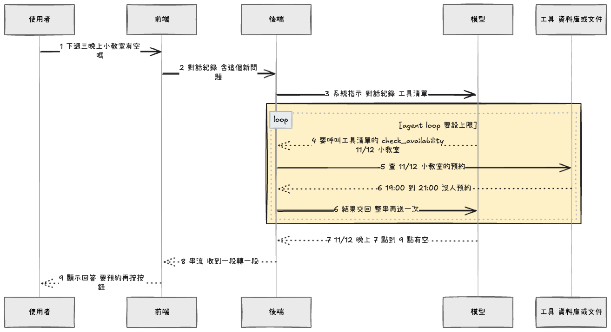

# Studiolane

A booking system for a dance studio. Its AI assistant, Kobeyee, reads a renter's message and fills in a booking form. Staff check the form and submit it. Kobeyee never creates a booking by itself, and its draft goes through the same rule checks as a form filled in by hand.

I built it after working part-time at a dance studio. Bookings lived in a Google Sheet, and each one meant checking for a free room, working out the rent, replying to the renter, and then updating the status and the calendar after payment. Statuses got missed and records stopped matching. I first built a system to automate the checks and record-keeping. Renters still book several slots at once and often cancel or reschedule, so typing in slots by hand still took time. That is why I added AI.

[Live demo](https://studiolane.vercel.app/) · [Blog: how I built it (Chinese)](https://app.notion.com/p/Kobeyee-Blog-002658bd0a6a82e9ad7681978ffe2463)

The demo database is on Supabase's free tier and pauses when idle, so the first load can be slow. Reload after a minute if it fails. Every name, price, and booking in this repo and in the demo is fictional.

https://github.com/user-attachments/assets/a9199893-4c21-4a2e-9f1a-b0fad26a679a

## How to run the project

The app is one Next.js project. The pages and server actions live in `src/`, and the database schema and seed data live in `supabase/`.

- Frontend: Next.js 16 (App Router), React 19, TypeScript, Tailwind CSS 4
- Backend: Next.js server actions, Supabase (Postgres), Drizzle ORM
- AI: Vercel AI SDK with OpenAI

## Prerequisites

- Node.js 22
- pnpm (via corepack)
- Docker, for the local Supabase stack
- [Supabase CLI](https://supabase.com/docs/guides/local-development/cli/getting-started)
- [gitleaks](https://github.com/gitleaks/gitleaks), for `pnpm pii`
- An OpenAI API key, for Kobeyee

## Setup and launch

1. `pnpm install`
2. `supabase start`. Local ports use the `544xx` range, see `supabase/config.toml`.
3. `cp .env.example .env.local`, then fill it in from `supabase status`. Add `OPENAI_API_KEY` for Kobeyee.
4. `pnpm dev`, then open http://localhost:3000.

Before pushing, run `pnpm lint`, `pnpm tsc --noEmit`, `pnpm test`, `pnpm knip`, and `pnpm pii`.

## Features

### Core

- A desktop home with widgets for today's bookings, bookings awaiting payment, and the next free slot
- A booking list with folders by period, room, status, and clashes
- A status menu on each booking row, and a tooltip that shows what a booking clashes with

### AI assistant

- Kobeyee reads a message that asks for one or more slots and fills in the booking form
- It lists the slots that can't be booked and says why
- It asks for required fields the message left out

### Booking rules

- Rental rules block rooms on given days and times
- A clash with another renter asks staff to confirm
- A clash with a confirmed booking, or the same renter's own booking, is blocked

## Technical architecture

### Frontend

- Next.js App Router with React Server Components
- Tailwind CSS 4 and a small UI kit in `src/components/ui/`
- Streaming with skeletons, so the desktop and window frames render before their data

### Backend

- Server actions call repositories built on Drizzle ORM
- Supabase Postgres, with migrations in `supabase/migrations/` pushed by GitHub Actions
- One error boundary on the server turns failures into typed results

### AI

- `gpt-5-mini` through the Vercel AI SDK, returning structured output
- A Zod schema checks the model output on the server

### Quality and delivery

- ESLint blocks raw HTML controls outside the UI kit, and gitleaks blocks real personal data
- CI runs lint, build, type check, knip, unit, database, and Playwright tests on every pull request and on `main`
- Vercel builds a preview for every pull request and deploys `main` to production
- GitHub Actions pushes database migrations when `supabase/migrations/` changes on `main`

## Where this is going

There is no real login yet, so every visitor is a demo admin. The new-booking, rental-rules, and batch-detail windows show a placeholder while they are rebuilt.

Kobeyee reads one message and returns one form today. Next, it becomes an agent: it keeps the conversation, decides from the intent whether to answer directly or call a read-only tool such as `check_availability`, and streams its reply. The loop has a step limit, and booking still needs a staff click.

Planned, not built yet. Example: staff ask "Is the small room free next Wednesday evening?"

- Studio knowledge: rent rules and procedures as data Kobeyee can look up
- Q&A: ask Kobeyee about rules or booking records
- Onboarding: Kobeyee walks a new staff member through a booking
